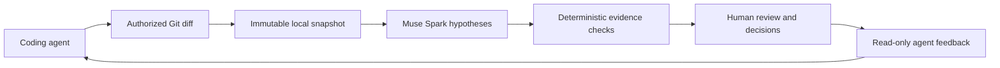
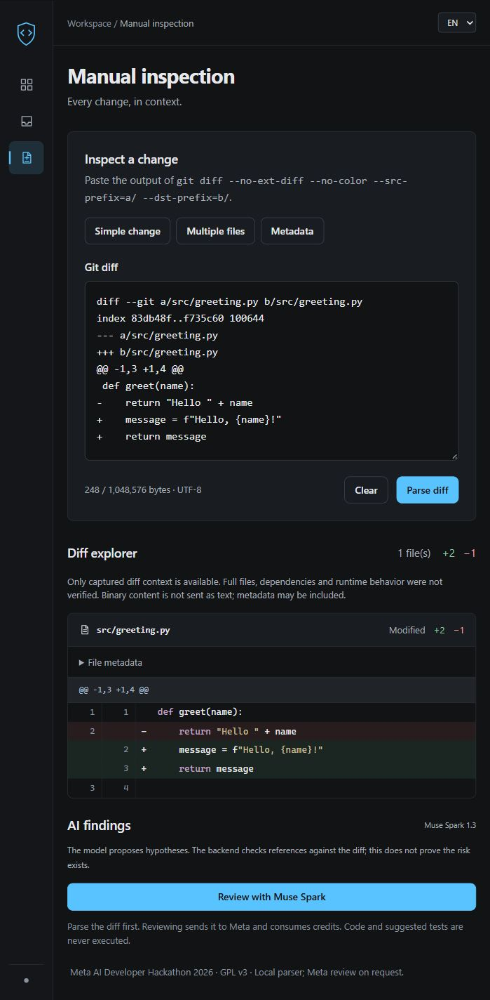

# AI Change Inspector

**An independent evidence layer for AI coding agents.**

**Your agent writes the code. An independent model reviews the changes. You make the decision.**

AI coding agents can change code faster than a developer can review it. AI Change Inspector
captures a Git diff, asks Meta Muse Spark for risk hypotheses, and independently checks that
each citation actually exists in the captured evidence. The developer makes and records the decision.
A valid citation locates code; it does not prove a bug or a fix.

## How it works



- Local React diff explorer with evidence ranges, keyboard focus and return-to-finding navigation.
- Persistent review inbox, Markdown export, search, filters and parent–child comparisons.
- Human decisions and comments remain separate from model hypotheses.
- Bounded sequential batches, coverage diagnostics and explicitly confirmed selective recovery.
- Local stdio MCP tools and a portable agent Skill; English and Spanish interface.
- No execution of audited code or model-suggested tests. No automatic paid retries.

## Try it

Requirements: **Python 3.12**, **Node.js 24.x (recommended) or 22.x ≥22.12**, npm 9+ and Git on PATH.
Dependencies are pinned. An API key is needed only for model analysis.

Windows PowerShell, from the checkout:

```powershell
.\scripts\setup.ps1
.\scripts\start.ps1
```

Linux / macOS, from the checkout:

```bash
bash scripts/setup.sh
bash scripts/start.sh
```

Open [the application](http://127.0.0.1:5173/) and [API documentation](http://127.0.0.1:8000/docs).
Setup preserves existing `.env` and SQLite. Start runs one API worker, binds only to
`127.0.0.1`, and refuses occupied ports. It does not start MCP or an audit.

**Without credentials:** open Diff explorer, load an included example and choose **Parse diff**.
This is real local parsing of synthetic source changes, not a simulated Muse Spark review.
See the [judge walkthrough](docs/demo.md).

## Platforms and documentation

| Platform | Status |
| --- | --- |
| Windows 10/11 | Windows laptop tested; not every OS version tested |
| Ubuntu/Debian and other modern Linux | Portable implementation; native execution not yet verified |
| macOS Intel / Apple Silicon | Portable implementation; native execution and wheel availability not yet verified |

- [Installation, manual commands, configuration and troubleshooting](docs/installation.md)
- [MCP connection, Skill installation and first audit](docs/mcp.md)
- [Architecture and large-audit behavior](docs/architecture.md)
- [Security boundaries and limitations](docs/security.md)
- [Demo walkthrough and release checklist](docs/demo.md)
- [Contributing and tests](CONTRIBUTING.md)
- [Actual validation results and publication blockers](docs/release-validation.md)

## Screenshots



Real application screenshot using only the included synthetic diff. No model request or private
review is shown.

## Security and cost

This is a **local, single-user application**, without authentication. Do not expose it directly
to the Internet. Audits send selected source changes to Meta and may consume credits.
Repository authorization and heuristic secret filters reduce risk; they do not guarantee removal
of sensitive information. Review what you submit. Agent provenance is declared, not authenticated.

## Roadmap

Native Linux/macOS validation, sanitized screenshots and broader MCP-client verification.
Cross-file reasoning remains limited across independent batches. No finding, empty report or
parent–child link certifies correctness or resolution.

## License

[GNU GPL version 3 only](LICENSE) (`GPL-3.0-only`). Dependencies retain their own licenses.
See [contribution guidance](CONTRIBUTING.md) before redistributing dependencies or submitting changes.

Third-party frontend attribution: [THIRD_PARTY_NOTICES.md](THIRD_PARTY_NOTICES.md).
